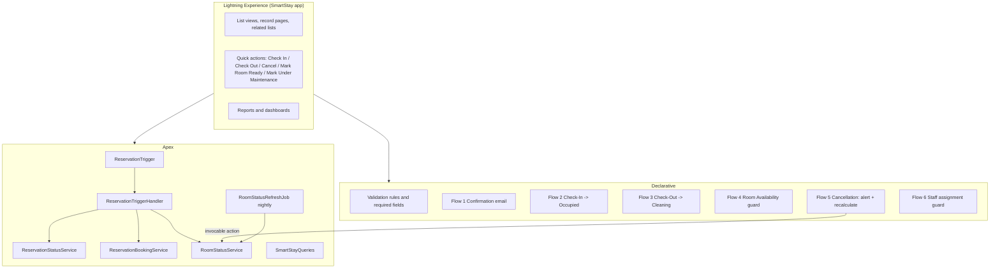
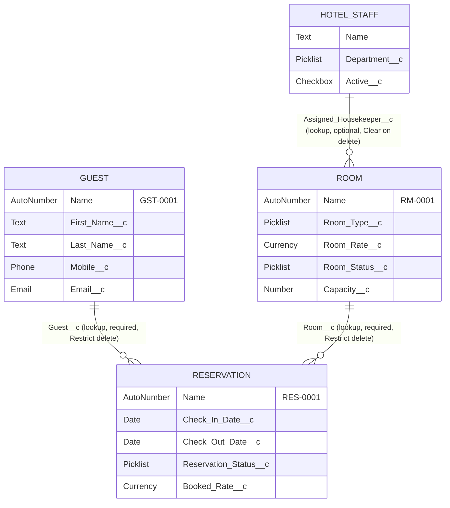

# SmartStay — Salesforce-Based Hotel Management System

**LNCT Salesforce Admin & Development Capstone Project — Wipro Salesforce COE Skilling Program**

| Item | Value |
|---|---|
| Platform | Salesforce Developer Edition (API version 65.0), Lightning Experience |
| Org used for results | Developer Edition org `00Dg800000OcyW7EAJ`, time zone Asia/Kolkata |
| Results captured on | 17 October 2026 |
| Apex test run | `707g800000pUcPh` — 81 tests, 81 passed, 0 failed, org-wide coverage 95% |

All people, phone numbers, email addresses (`@example.com`) and identity numbers in this project are fictional.

---

## Contents

1. [Project overview](#1-project-overview)
2. [Problem statement](#2-problem-statement)
3. [Project objectives](#3-project-objectives)
4. [Technology stack](#4-technology-stack)
5. [System architecture](#5-system-architecture)
6. [Salesforce object data model](#6-salesforce-object-data-model)
7. [Relationship diagram](#7-relationship-diagram)
8. [Field definitions](#8-field-definitions)
9. [Validation rules](#9-validation-rules)
10. [Formula fields](#10-formula-fields)
11. [Flows](#11-flows)
12. [Apex trigger](#12-apex-trigger)
13. [Apex handler and service classes](#13-apex-handler-and-service-classes)
14. [SOQL queries and their outputs](#14-soql-queries-and-their-outputs)
15. [Security and permission configuration](#15-security-and-permission-configuration)
16. [Reports and dashboards](#16-reports-and-dashboards)
17. [Sample data](#17-sample-data)
18. [Test cases and actual results](#18-test-cases-and-actual-results)
19. [Screenshots](#19-screenshots)
20. [Setup and deployment](#20-setup-and-deployment)
21. [Known limitations](#21-known-limitations)
22. [Conclusion and future enhancements](#22-conclusion-and-future-enhancements)
23. [Technical interview questions and answers](#23-technical-interview-questions-and-answers)

---

## 1. Project overview

SmartStay is a hotel management application built entirely on the Salesforce Platform. Front-desk staff register
guests, book rooms, check guests in and out, and cancel bookings; housekeeping maintains room readiness; accounts reads
booking amounts; management sees everything through reports and dashboards.

The application is native Salesforce: custom objects, validation rules, formula fields, record-triggered Flows, one Apex
trigger with handler and service classes, SOQL, role-based security, reports and dashboards. It uses no Lightning Web
Components, Aura, Visualforce or external systems.

What the app does, in one sentence each:

- **Rooms** carry type, floor, capacity, rate, amenities and a status that always reflects *today*.
- **Guests** carry contact details and identity information that only authorised roles can see.
- **Reservations** link a guest to a room for a date range; overlapping bookings are impossible, even when two users
  book at the same moment.
- **Hotel Staff** is the employee directory; inactive staff cannot be given new room assignments.

## 2. Problem statement

A small hotel that tracks rooms and bookings in registers or spreadsheets suffers from:

- **Double bookings**: two receptionists can promise the same room for the same nights.
- **Stale room status**: nobody knows reliably which rooms are occupied, need cleaning or are out of service.
- **Inconsistent billing**: amounts are recalculated by hand and change when the rate card changes.
- **No access control**: anyone with the register sees guest identity documents.
- **No management view**: occupancy, cancellations and revenue have to be compiled manually.

## 3. Project objectives

1. Model rooms, guests, reservations and staff as related Salesforce objects.
2. Enforce data quality with validation rules and required fields.
3. Prevent overlapping bookings using actual reservation dates, safely under concurrent use and in bulk.
4. Keep room status consistent with check-in, check-out, cancellation and housekeeping, without competing automation.
5. Notify guests on booking and managers on cancellation.
6. Give each role exactly the access it needs (least privilege), including protection of guest identity data.
7. Provide operational and revenue reports and dashboards from live data.
8. Prove the behaviour with Apex tests that assert real outcomes.

## 4. Technology stack

| Area | Used in SmartStay |
|---|---|
| Platform | Salesforce Platform, Lightning Experience, Lightning app (SmartStay Hotel Management System) |
| Administration | 4 custom objects, 36 custom fields, page layouts, compact layouts, list views, quick actions, picklists, lookup relationships, related lists, field history tracking |
| Automation | 6 record-triggered Flows, 1 email alert, 1 classic email template, 1 scheduled batch job |
| Backend | 1 Apex trigger, 7 Apex classes (handler, services, nightly job, SOQL queries, constants), 7 Apex test classes (incl. data factory) |
| Security | 5 roles, 1 custom profile, 6 permission sets, 1 custom permission, OWD per object, 5 ownership-based sharing rules, field-level security |
| Reporting | 4 custom report types, 10 reports (summary and tabular, 3 with embedded charts), 3 dashboards |
| Tools | Salesforce CLI 2.126, VS Code project layout (SFDX), Git |

Record types were not needed: every room, guest and reservation follows the same process and page layout.

## 5. System architecture



### Order of execution for a reservation save

Salesforce runs automation in a fixed order. SmartStay assigns each responsibility to one place:

| Step | What runs | SmartStay responsibility |
|---|---|---|
| 1 | System validation (required fields, field formats) | Guest, Room, dates and guest count must be present |
| 2 | Before-save Flows | none on Reservation |
| 3 | **Before triggers** | status rules, check-in rules, maintenance check, booked rate, **overlap prevention with room lock** |
| 4 | Custom validation rules | date order, guest count, capacity, past dates, history lock |
| 5 | Record saved (not yet committed) | |
| 6 | **After triggers** | recalculate room status when a booking's room or dates change |
| 7 | After-save Flows | confirmation email (create), Occupied (check-in), Cleaning (check-out), alert + recalculate (cancel) |
| 8 | Commit | Emails are sent only after commit |

### Who owns Room Status (no competing automation)

| Event | Owner | Result |
|---|---|---|
| Reservation created or its room/dates changed | Apex `RoomStatusService` (after trigger) | Reserved if a guest is due today, else Available (Maintenance/Cleaning kept) |
| Status → Checked-In | Flow 2 | Occupied |
| Status → Checked-Out | Flow 3 | Cleaning |
| Status → Cancelled | Flow 5 → invocable `RoomStatusService` | Recalculated from the room's other reservations |
| Staff sets room to Available | Flow 4 (before save) | Blocked if a guest is in; switched to Reserved if a guest is due today |
| Midnight | `RoomStatusRefreshJob` → `RoomStatusService` | Statuses follow the new date |

The Apex handler deliberately ignores status-only changes, so Flows 2, 3 and 5 are the only automation reacting to
them. Flow 4 uses the same rules as `RoomStatusService`, so the two never disagree.

## 6. Salesforce object data model

| Object | API name | Record name | Purpose | OWD |
|---|---|---|---|---|
| Room | `Room__c` | Room Number, Auto Number `RM-{0000}` | Bookable room and its current status | Public Read Only |
| Guest | `Guest__c` | Guest ID, Auto Number `GST-{0000}` | Guest contact and identity details | Private |
| Reservation | `Reservation__c` | Reservation Number, Auto Number `RES-{0000}` | A guest's stay in one room for a date range | Private |
| Hotel Staff | `Hotel_Staff__c` | Employee Name (Text) | Employee directory | Public Read Only |

Field history tracking is on for Room (rate, status), Reservation (guest, room, dates, status) and Hotel Staff (active),
so changes to these fields are audited on the record page.

## 7. Relationship diagram



**Relationship model, as required by the brief:**

- **Guest → Reservation** and **Room → Reservation** are **lookup relationships**, not master-detail. A reservation keeps
  its own owner and sharing (Private OWD), which master-detail would not allow.
- Both lookups are **required**, so a reservation can never exist without a guest and a room.
- Both use the **Restrict** delete option: a guest or room that has reservations cannot be deleted, which protects
  booking history. (Verified by test `guestWithReservationsCannotBeDeleted`: Salesforce returns `DELETE_FAILED`.)
- Child relationship names are `Reservations__r` on both parents. They are used in SOQL sub-queries and in the
  "Rooms with Reservations" / "Guests with Reservations" report types.
- Guest and Room record pages show a **Reservations** related list; the Reservation page shows the guest and room
  lookups plus formula fields Guest Name, Room Number and Room Type.
- Room → Hotel Staff (Assigned Housekeeper) is an optional lookup with **Clear the value** on delete.
- The Room lookup has an *optional* lookup filter that hides Maintenance rooms from the lookup search. It is optional on
  purpose: the real enforcement is in Apex, so a room that goes into maintenance after booking does not make the existing
  reservation impossible to edit or cancel.

## 8. Field definitions

### Room (`Room__c`)

| Label | API name | Type | Rules |
|---|---|---|---|
| Room Number | `Name` | Auto Number `RM-{0000}`, starts at 1 | Unique by construction |
| Room Type | `Room_Type__c` | Picklist: Single, Double, Deluxe, Suite | Required |
| Floor | `Floor__c` | Number(2,0) | Required, not negative |
| Room Rate | `Room_Rate__c` | Currency(8,2) | > 0 (validation rule), history tracked |
| Room Status | `Room_Status__c` | Picklist: Available, Reserved, Occupied, Cleaning, Maintenance | Default Available, history tracked |
| Capacity | `Capacity__c` | Number(2,0) | > 0 (validation rule) |
| Amenities | `Amenities__c` | Multi-select picklist: Wi-Fi, TV, AC, Breakfast, Parking | |
| Assigned Housekeeper | `Assigned_Housekeeper__c` | Lookup(Hotel Staff) | Active Housekeeping staff only (Flow 6) |

### Guest (`Guest__c`)

| Label | API name | Type | Rules |
|---|---|---|---|
| Guest ID | `Name` | Auto Number `GST-{0000}` | |
| First Name | `First_Name__c` | Text(40) | Required |
| Last Name | `Last_Name__c` | Text(80) | Required |
| Full Name | `Full_Name__c` | Formula (Text) | First + Last name |
| Mobile Number | `Mobile__c` | Phone | Required, format rule |
| Email | `Email__c` | Email | Required; Email type rejects invalid addresses |
| Date of Birth | `Date_of_Birth__c` | Date | Not in future, not > 120 years ago |
| Age | `Age__c` | Formula (Number) | Completed years; blank if no DOB |
| ID Type | `ID_Type__c` | Picklist: Aadhaar, Passport, Driving License, Other | Required together with ID Number |
| ID Number | `ID_Number__c` | Text(30) | Restricted by field-level security |
| Address | `Address__c` | Long Text Area(2000) | |

### Reservation (`Reservation__c`)

| Label | API name | Type | Rules |
|---|---|---|---|
| Reservation Number | `Name` | Auto Number `RES-{0000}` | |
| Guest | `Guest__c` | Lookup(Guest) | Required, Restrict delete |
| Room | `Room__c` | Lookup(Room) | Required, Restrict delete |
| Check-In Date | `Check_In_Date__c` | Date | Required, not in the past for new bookings |
| Check-Out Date | `Check_Out_Date__c` | Date | Required, after Check-In Date |
| Number of Guests | `Number_of_Guests__c` | Number(3,0) | Required, ≥ 1, ≤ room capacity |
| Reservation Status | `Reservation_Status__c` | Picklist: Confirmed, Checked-In, Checked-Out, Cancelled | Default Confirmed; transitions enforced in Apex |
| Number of Nights | `Number_of_Nights__c` | Formula (Number) | Check-Out − Check-In |
| Booked Rate | `Booked_Rate__c` | Currency | Set by Apex when the room is booked; read-only for staff |
| Estimated Amount | `Estimated_Amount__c` | Formula (Currency) | Nights × Booked Rate |
| Special Request | `Special_Request__c` | Long Text Area(2000) | |
| Guest Name | `Guest_Name__c` | Formula (Text) | From Guest |
| Room Number | `Room_Number__c` | Formula (Text) | From Room |
| Room Type | `Room_Type__c` | Formula (Text) | From Room |
| Confirmation Email Status | `Confirmation_Email_Status__c` | Picklist: Sent, Failed, Suppressed | Set by Flow 1; prevents duplicate emails |

### Hotel Staff (`Hotel_Staff__c`)

| Label | API name | Type | Rules |
|---|---|---|---|
| Employee Name | `Name` | Text | Required (standard name field) |
| Department | `Department__c` | Picklist: Reception, Housekeeping, Manager, Accounts | Required |
| Mobile | `Mobile__c` | Phone | Required, format rule |
| Email | `Email__c` | Email | Required |
| Shift | `Shift__c` | Picklist: Morning, Evening, Night | |
| Active | `Active__c` | Checkbox | Default checked, history tracked |

### Room-rate changes and existing reservations

When a reservation is created, or moved to a different room, Apex copies the room's current rate into **Booked Rate**.
Estimated Amount is calculated from Booked Rate, so **changing a room's rate later does not change existing
reservations** — only new bookings use the new rate. This is verified by test
`roomRateChangeDoesNotAlterExistingBooking` (rate changed from 3,000 to 5,000; the booking keeps 2 × 3,000 = 6,000).
The formula falls back to the room's current rate only if Booked Rate is blank (e.g. records loaded around the trigger).

## 9. Validation rules

Field-level "required" settings enforce mandatory values everywhere (UI, API, Apex, data loads) with Salesforce's
standard `REQUIRED_FIELD_MISSING` error. The rules below add the business checks.

| Object | Rule | Error condition (summary) | Message |
|---|---|---|---|
| Room | Room_Rate_Must_Be_Positive | Rate blank or ≤ 0 | Room Rate is required and must be greater than zero. |
| Room | Capacity_Must_Be_Positive | Capacity blank or ≤ 0 | Capacity is required and must be at least 1 guest. |
| Room | Floor_Cannot_Be_Negative | Floor < 0 | Floor cannot be negative (use 0 for the ground floor). |
| Room | Room_Status_Required | Status blank | Room Status is required. |
| Guest | Date_Of_Birth_Not_In_Future | DOB > TODAY() | Date of Birth cannot be in the future. |
| Guest | Date_Of_Birth_Plausible | DOB more than 1,440 months ago | Date of Birth cannot be more than 120 years ago. |
| Guest | Mobile_Number_Format | Not `^[+]?[0-9 ()-]{10,20}$` | Enter a valid mobile number… |
| Guest | ID_Number_Required_With_ID_Type | Type chosen, number blank | Enter the ID Number for the selected ID Type. |
| Guest | ID_Type_Required_With_ID_Number | Number entered, type blank | Select the ID Type for this ID Number. |
| Reservation | Check_Out_After_Check_In | Check-Out ≤ Check-In | Check-Out Date must be later than Check-In Date. |
| Reservation | Number_Of_Guests_Positive | Guests blank or ≤ 0 | Number of Guests must be at least 1. |
| Reservation | Guests_Within_Room_Capacity | Guests > `Room__r.Capacity__c` (on create or when guests/room change) | Number of Guests exceeds the capacity of the selected room. |
| Reservation | Check_In_Not_In_Past | New/changed Check-In < TODAY() and user lacks the Historical Data Load permission | Check-In Date cannot be in the past. |
| Reservation | Completed_Reservation_Is_Locked | Previous status Checked-Out or Cancelled and room, guest, dates or guest count changed | …are history: room, guest, dates and guest count cannot be changed. |
| Reservation | Arrival_Fixed_After_Check_In | Previous status Checked-In and room, guest or Check-In Date changed | After check-in… only the Check-Out Date can be extended. |
| Hotel Staff | Staff_Mobile_Number_Format | Not a valid number pattern | Enter a valid mobile number… |

How each requirement in the brief is met:

| Requirement | Mechanism |
|---|---|
| Room number uniqueness | Auto Number record name; Salesforce generates each number once (a validation rule cannot query other records, so it could not check uniqueness anyway) |
| Valid email format | Email field type (verified: `INVALID_EMAIL_ADDRESS` in test `guestEmailFormatIsValidated`) |
| No negative age | Age is derived from Date of Birth, which cannot be in the future |
| Room and Guest must be selected | Required lookup fields |
| Room cannot be under Maintenance | **Apex** (`ReservationBookingService`): checked against the *locked* room record, so the status cannot change between the check and the save |
| No overlapping active reservation | **Apex** — a validation rule only sees the record being saved and its parents, never sibling reservations, so it cannot detect overlaps |

## 10. Formula fields

| Field | Formula | Handling of blanks / invalid values |
|---|---|---|
| Guest `Age__c` | `YEAR(TODAY()) - YEAR(DOB) - IF(birthday not reached this year, 1, 0)` | Blank when DOB is blank (`IF(ISBLANK(...), NULL, ...)`, blanks treated as blanks). Counts completed years exactly — test `guestAgeIsCalculatedFromDateOfBirth` checks a birthday today (30) and tomorrow (29). |
| Guest `Full_Name__c` | `TRIM(First_Name__c & " " & Last_Name__c)` | Both parts required |
| Reservation `Number_of_Nights__c` | `IF(OR(ISBLANK(in), ISBLANK(out)), NULL, MAX(out - in, 0))` | Blank if a date is missing; never negative (an inverted range is also rejected by validation) |
| Reservation `Estimated_Amount__c` | `IF(ISBLANK(Number_of_Nights__c), NULL, Number_of_Nights__c * BLANKVALUE(Booked_Rate__c, Room__r.Room_Rate__c))` | Blank if nights unknown; uses Booked Rate, falls back to the room's rate |
| Reservation `Guest_Name__c` | `TRIM(Guest__r.First_Name__c & " " & Guest__r.Last_Name__c)` | Cross-object |
| Reservation `Room_Number__c` | `Room__r.Name` | Cross-object |
| Reservation `Room_Type__c` | `TEXT(Room__r.Room_Type__c)` | Picklist converted to text |

Subtracting two Date values in a formula gives the number of days between them, which equals the number of nights
because the guest leaves on the check-out date.

## 11. Flows

All six are record-triggered Flows built in auto-layout. API names start with `SmartStay_`.

### Flow 1 — SmartStay - Reservation Confirmation (`SmartStay_Reservation_Confirmation`)

- **Trigger:** Reservation created; after save.
- **Entry criteria:** Status = Confirmed **and** Confirmation Email Status is blank.
- **Logic:** Send Email action to `Guest.Email` with an HTML body (reservation number, room number and type, check-in and
  check-out dates, nights, guests, estimated amount) → update Confirmation Email Status = **Sent**.
- **Fault path:** if the email fails, Confirmation Email Status = **Failed**; the booking is kept.
- **Duplicate prevention:** runs only on create and only while the status field is blank. Bulk loads set it to
  **Suppressed** to skip emails. Test `confirmationFlowEmailsGuestOnce` confirms the status becomes Sent and an edit does
  not resend.

### Flow 2 — SmartStay - Reservation Check-In (`SmartStay_Reservation_Check_In`)

- **Trigger:** Reservation updated; after save. **Entry:** Status = Checked-In **and** Status is changed.
- **Logic:** update the related Room to **Occupied**, only if it is not already Occupied (avoids a redundant update).
- **Validity:** the check-in itself is validated earlier, in the before trigger (date window, room not in
  Maintenance/Cleaning, no other guest checked in).
- **Fault path:** a Custom Error rolls back the whole check-in, so a reservation can never be Checked-In while its room
  is not Occupied.

### Flow 3 — SmartStay - Reservation Check-Out (`SmartStay_Reservation_Check_Out`)

- **Trigger:** Reservation updated; after save. **Entry:** Status = Checked-Out **and** Status is changed.
- **Logic:** update the related Room to **Cleaning**, unless it is already Cleaning or in Maintenance.
- **History:** the reservation is not modified; validation rule `Completed_Reservation_Is_Locked` keeps it unchanged.
- **Fault path:** Custom Error rolls back the check-out.

### Flow 4 — SmartStay - Room Availability (`SmartStay_Room_Availability`)

- **Trigger:** Room updated; **before save**. **Entry:** Room Status = Available **and** Room Status is changed.
- **Logic:**
  1. Get a Checked-In reservation for this room → if found, **Custom Error**: the room cannot be made Available while
     a guest is checked in.
  2. Otherwise get a Confirmed reservation covering today → if found, set the status to **Reserved** instead (a guest is
     due today).
  3. Otherwise the room is saved as Available.
- **Why before-save:** it changes the record being saved without an extra DML statement.

### Flow 5 — SmartStay - Reservation Cancellation (`SmartStay_Reservation_Cancellation`)

- **Trigger:** Reservation updated; after save. **Entry:** Status = Cancelled **and** Status is changed.
- **Logic:**
  1. Email alert `Reservation_Cancelled_Manager_Alert` → users in the **Hotel Manager** role, template
     *SmartStay Reservation Cancelled*. If the email fails, the flow continues (the fault path goes to step 2).
  2. Apex action **Recalculate Room Status** (`RoomStatusService`) — checks the room's other reservations and keeps
     Maintenance and Cleaning, so the room is freed only when nothing else needs it.
- **Freed dates:** the overlap check ignores Cancelled reservations, so the dates are bookable immediately (test
  `cancelledReservationDoesNotBlockDates`; sample booking RES-0019 re-uses the dates of cancelled RES-0016).
- **Fault path:** if recalculation fails, a Custom Error rolls back the cancellation.

### Flow 6 — SmartStay - Staff Assignment Guard (`SmartStay_Staff_Assignment_Guard`)

- **Trigger:** Room created or updated; before save. **Entry formula:**
  `AND(NOT(ISBLANK(Assigned_Housekeeper__c)), OR(ISNEW(), ISCHANGED(Assigned_Housekeeper__c)))`
- **Logic:** get the staff record → Custom Error if **inactive**, or if the department is not **Housekeeping**.
- Existing assignments are not re-checked when someone is later deactivated (see Known limitations).

## 12. Apex trigger

`ReservationTrigger` on `Reservation__c` (before insert, before update, after insert, after update) contains one line:

```apex
trigger ReservationTrigger on Reservation__c(before insert, before update, after insert, after update) {
    new ReservationTriggerHandler().run();
}
```

One trigger per object, with no logic in it: execution order is explicit in the handler and the logic is unit-testable.

## 13. Apex handler and service classes

| Class | Sharing | Purpose |
|---|---|---|
| `ReservationTriggerHandler` | with sharing | Dispatches each trigger event to the services; ignores status-only changes after save (Flows own them) |
| `ReservationStatusService` | without sharing | New records start Confirmed; allowed transitions; check-in rules |
| `ReservationBookingService` | without sharing | Room lock, maintenance check, booked rate, overlap prevention |
| `RoomStatusService` | without sharing | Single rule set for room status; invocable from Flow 5 |
| `RoomStatusRefreshJob` | without sharing | Schedulable + Batchable nightly recalculation |
| `SmartStayQueries` | with sharing, `WITH USER_MODE` | Documented SOQL queries |
| `SmartStayConstants` | — | Picklist values and names in one place |

**Why some classes are `without sharing`:** a receptionist must not be able to double-book a room just because the
conflicting reservation is owned by someone whose records they cannot see. The services only read what they need and
reveal nothing beyond the conflicting reservation's number and dates. Classes that return data to users
(`SmartStayQueries`) enforce sharing and field-level security.

### Status lifecycle (`ReservationStatusService`)

```
Confirmed ──► Checked-In ──► Checked-Out   (final)
    └───────► Cancelled                     (final)
```

- New reservations must be Confirmed.
- **Check-in** is allowed only when today is on/after the Check-In Date and before the Check-Out Date, the room is not
  in Maintenance or Cleaning, and no other guest is checked in to that room (also within the same save).
- Users with the custom permission **SmartStay Historical Data Load** may record check-ins outside the date window
  (used only to load past stays); room rules still apply to them.

### Overlap prevention (`ReservationBookingService`)

A stay occupies `[Check-In Date, Check-Out Date)`; the guest leaves on the check-out date, so a new guest may arrive that
day. Two reservations conflict when

```
existing.Check_In_Date__c  < new.Check_Out_Date__c
AND existing.Check_Out_Date__c > new.Check_In_Date__c
AND same room AND existing is not Cancelled AND existing is not the record being updated
```

Algorithm, per trigger batch (insert and update):

1. **Select candidates** — new records, or updates where the room or a date changed. Records with missing or inverted
   dates are left to the validation rules; Cancelled and Checked-Out records are not re-checked (but Checked-Out stays
   still block their dates).
2. **Lock the rooms** — `SELECT … FROM Room__c WHERE Id IN :roomIds FOR UPDATE` (one query).
3. **Room rules** — reject Maintenance rooms; copy the room rate into Booked Rate (only when the room is newly chosen).
4. **One overlap query** for all candidate rooms over the batch's overall date window, excluding Cancelled reservations
   and every record in the current save (their *new* values are compared instead).
5. **Compare in memory** — against saved bookings, then against bookings earlier in the same save. Conflicts get a
   record-level error naming the room, dates and the conflicting reservation number.

No SOQL or DML runs inside a loop. Test `bulkInsertOf200ReservationsUsesFewQueries` inserts 200 reservations across 20
rooms and asserts the transaction stays within 10 queries; `unchangedUpdateSkipsOverlapQuery` asserts that an edit that
does not touch room or dates uses **0** queries.

### Concurrency

Without a lock, two users booking the same room at the same moment could both pass the overlap query, because neither
transaction can see the other's uncommitted row.

`FOR UPDATE` on the room row serialises such transactions: the second one waits for the first to commit, then runs its
overlap query and sees the committed booking. Limits, stated honestly:

- The wait is bounded (about 10 seconds). If exceeded, the second save fails with `UNABLE_TO_LOCK_ROW` and the user
  retries; there is no double booking.
- The protection covers every path that fires triggers (UI, API, Flows, Apex, data loads with triggers). It cannot
  protect data written with triggers disabled, which nothing in this app does.
- Apex tests run in a single transaction, so they cannot simulate two concurrent users; the locking is verified by
  design, not by a test.

### Room status (`RoomStatusService`)

Rules in order: Maintenance stays Maintenance → a checked-in guest makes it **Occupied** → Cleaning stays Cleaning → a
Confirmed reservation covering today makes it **Reserved** → otherwise **Available**. Rooms are updated only when the
value actually changes. Future bookings do not mark a room Reserved: status describes today, while future
double-booking is prevented by dates. Because "today" moves at midnight, `RoomStatusRefreshJob` (scheduled 00:05 daily,
job name *SmartStay Daily Room Status Refresh*) recalculates all non-maintenance rooms in batches of 200.

### Recursion and error handling

- Flow 1 updates the reservation it was triggered by; the trigger runs again but finds no changed room, dates or status,
  so it does no queries or DML. No static "already ran" flags are needed.
- Errors use `addError` with user-facing messages; no exception is caught and ignored. Flow fault paths either record
  the outcome (email) or roll back the transaction (room updates).
- Debug statements in scripts print record numbers and statuses only, never identity data.

## 14. SOQL queries and their outputs

All queries live in `SmartStayQueries` and run `WITH USER_MODE`. Output below was produced in the org by
`scripts/apex/soql-demo.apex` on 17/10/2026 (dates dd/mm/yyyy, amounts in the org currency).

**Query 1 — all reservations of a room.** Purpose: room history for the front desk.

```sql
SELECT Id, Name, Guest_Name__c, Check_In_Date__c, Check_Out_Date__c, Number_of_Guests__c,
       Reservation_Status__c, Estimated_Amount__c
FROM Reservation__c WHERE Room__c = :roomId WITH USER_MODE ORDER BY Check_In_Date__c DESC
```
```
RES-0013 / Aarav Sharma / 25/10/2026 -> 27/10/2026 / Confirmed / 5000.00
RES-0012 / Zoya Khan / 22/10/2026 -> 25/10/2026 / Confirmed / 7500.00
RES-0005 / Vikram Singh / 05/10/2026 -> 07/10/2026 / Cancelled / 5000.00
RES-0001 / Aarav Sharma / 27/09/2026 -> 30/09/2026 / Checked-Out / 7500.00
```

**Query 2 — all reservations of a guest.** Purpose: guest stay history.

```sql
SELECT Id, Name, Room_Number__c, Room_Type__c, Check_In_Date__c, Check_Out_Date__c,
       Reservation_Status__c, Estimated_Amount__c
FROM Reservation__c WHERE Guest__c = :guestId WITH USER_MODE ORDER BY Check_In_Date__c DESC
```
```
RES-0013 / RM-0001 (Single) / 25/10/2026 -> 27/10/2026 / Confirmed
RES-0001 / RM-0001 (Single) / 27/09/2026 -> 30/09/2026 / Checked-Out
```

**Query 3 — active reservations of a room.** Purpose: what still needs the room. Active = checked in, or Confirmed and
not yet ended.

```sql
SELECT Id, Name, Guest_Name__c, Check_In_Date__c, Check_Out_Date__c, Reservation_Status__c
FROM Reservation__c
WHERE Room__c = :roomId
  AND (Reservation_Status__c = 'Checked-In'
       OR (Reservation_Status__c = 'Confirmed' AND Check_Out_Date__c >= TODAY))
WITH USER_MODE ORDER BY Check_In_Date__c ASC
```
```
RES-0012 / 22/10/2026 -> 25/10/2026 / Confirmed
RES-0013 / 25/10/2026 -> 27/10/2026 / Confirmed
```

**Query 4 — reservations within a date range** (stay fully inside the range). Rejects a missing or inverted range with
`IllegalArgumentException`.

```sql
SELECT Id, Name, Guest_Name__c, Room_Number__c, Check_In_Date__c, Check_Out_Date__c, Reservation_Status__c
FROM Reservation__c
WHERE Check_In_Date__c >= :startDate AND Check_Out_Date__c <= :endDate
WITH USER_MODE ORDER BY Check_In_Date__c ASC, Name ASC
```
Range 17/10/2026 – 31/10/2026:
```
RES-0010 / RM-0003 / 17/10/2026 -> 20/10/2026 / Confirmed
RES-0011 / RM-0009 / 17/10/2026 -> 19/10/2026 / Confirmed
RES-0018 / RM-0004 / 18/10/2026 -> 20/10/2026 / Confirmed
RES-0016 / RM-0010 / 19/10/2026 -> 21/10/2026 / Cancelled
RES-0019 / RM-0010 / 19/10/2026 -> 21/10/2026 / Confirmed
RES-0014 / RM-0006 / 20/10/2026 -> 23/10/2026 / Confirmed
RES-0012 / RM-0001 / 22/10/2026 -> 25/10/2026 / Confirmed
RES-0013 / RM-0001 / 25/10/2026 -> 27/10/2026 / Confirmed
RES-0015 / RM-0008 / 27/10/2026 -> 31/10/2026 / Confirmed
```

**Query 5 — parent-to-child: a room with its reservations** (child relationship `Reservations__r`).

```sql
SELECT Id, Name, Room_Type__c, Room_Status__c, Room_Rate__c, Capacity__c,
       (SELECT Id, Name, Guest_Name__c, Check_In_Date__c, Check_Out_Date__c, Reservation_Status__c
        FROM Reservations__r ORDER BY Check_In_Date__c DESC)
FROM Room__c WHERE Id = :roomId WITH USER_MODE
```
```
RM-0001 Single Available rate 2500.00 -> 4 reservations
   RES-0013 / Aarav Sharma / Confirmed
   RES-0012 / Zoya Khan / Confirmed
   RES-0005 / Vikram Singh / Cancelled
   RES-0001 / Aarav Sharma / Checked-Out
```

**Query 6 — child-to-parent: reservations with room and guest details** (lookups `Room__r`, `Guest__r`).

```sql
SELECT Id, Name, Check_In_Date__c, Check_Out_Date__c, Reservation_Status__c,
       Room__r.Name, Room__r.Room_Type__c, Room__r.Room_Rate__c,
       Guest__r.First_Name__c, Guest__r.Last_Name__c, Guest__r.Email__c, Guest__r.Mobile__c
FROM Reservation__c WHERE Check_In_Date__c >= :fromDate
WITH USER_MODE ORDER BY Check_In_Date__c ASC LIMIT 200
```
From 17/10/2026:
```
RES-0011 / RM-0009 Single @ 2500.00 / Nikhil Desai <nikhil.desai@example.com>
RES-0010 / RM-0003 Double @ 3800.00 / Lakshmi Menon <lakshmi.menon@example.com>
RES-0018 / RM-0004 Double @ 3800.00 / Sneha Reddy <sneha.reddy@example.com>
RES-0019 / RM-0010 Double @ 3800.00 / Kabir Malhotra <kabir.malhotra@example.com>
RES-0016 / RM-0010 Double @ 3800.00 / Ananya Iyer <ananya.iyer@example.com>
RES-0014 / RM-0006 Deluxe @ 5500.00 / Diya Patel <diya.patel@example.com>
RES-0012 / RM-0001 Single @ 2500.00 / Zoya Khan <zoya.khan@example.com>
RES-0013 / RM-0001 Single @ 2500.00 / Aarav Sharma <aarav.sharma@example.com>
RES-0015 / RM-0008 Suite @ 9000.00 / Rohan Verma <rohan.verma@example.com>
RES-0017 / RM-0011 Deluxe @ 5800.00 / Vikram Singh <vikram.singh@example.com>
```

**Query 7 — parent-to-child from Guest.** Output: `GST-0001 Aarav Sharma -> 2 reservations`.

**Query 8 — aggregate grouped by a parent field.**

```sql
SELECT Room__r.Room_Type__c roomType, COUNT(Id) total
FROM Reservation__c WHERE Reservation_Status__c != 'Cancelled'
WITH USER_MODE GROUP BY Room__r.Room_Type__c
```
Output: `{Deluxe=4, Double=6, Single=5, Suite=2}`

The booking logic itself uses two further queries: the room lock (`… FOR UPDATE`) and the batch overlap query shown in
section 13. Test `soqlHelperEnforcesUserMode` proves a Housekeeping user cannot read reservations through these methods.

## 15. Security and permission configuration

### Role hierarchy

```
Hotel CEO (SmartStay_CEO)                 ← the system administrator user
└── Hotel Manager (SmartStay_Hotel_Manager)
    ├── Receptionist (SmartStay_Receptionist)
    ├── Housekeeping (SmartStay_Housekeeping)
    └── Accounts (SmartStay_Accounts)
```

### Users created in the org (`scripts/apex/setup-demo-users.apex`)

| Persona | Username | Profile | Role | Permission set |
|---|---|---|---|---|
| Hotel CEO | the admin user | System Administrator | Hotel CEO | SmartStay Administrator |
| Hotel Manager | `ssmgr@smartstay-ocyw7.demo` | SmartStay Hotel Staff | Hotel Manager | SmartStay Hotel Manager |
| Receptionist 1 | `ssrec1@smartstay-ocyw7.demo` | SmartStay Hotel Staff | Receptionist | SmartStay Receptionist |
| Receptionist 2 | `ssrec2@smartstay-ocyw7.demo` | SmartStay Hotel Staff | Receptionist | SmartStay Receptionist |
| Housekeeping | `sshk@smartstay-ocyw7.demo` | SmartStay Hotel Staff | Housekeeping | SmartStay Housekeeping |
| Accounts | `ssacc@smartstay-ocyw7.demo` | SmartStay Hotel Staff | Accounts | SmartStay Accounts |

**Licensing:** this Developer Edition org has 4 *Salesforce* licenses (2 already used by administrator accounts that came with the org) and 6
*Salesforce Platform* licenses. Staff users use the Platform license, which supports custom objects and apps, so all 5
fit. New users also default to a *Salesforce CRM Content* feature license, which this org has too few of; the script turns
that off (`UserPermissionsSFContentUser = false`) because staff do not need it. No welcome emails are sent; the users'
email is the administrator's, so password resets reach the person running the demo.

### Profile and permission sets (least privilege)

The **SmartStay Hotel Staff** profile (Salesforce Platform license) grants only login, Lightning Experience, Run Reports
and app visibility. All object and field access comes from permission sets:

| Permission set | Room | Guest | Reservation | Hotel Staff |
|---|---|---|---|---|
| SmartStay Receptionist | Read | Create, Read, Edit | Create, Read, Edit (**no Delete**) | Read |
| SmartStay Hotel Manager | Full + View All + Modify All | Full + View All + Modify All | Full + View All + Modify All | Full + View All + Modify All |
| SmartStay Housekeeping | Read, Edit | **none** | **none** | Read |
| SmartStay Accounts | Read | Read | Read | Read |
| SmartStay Administrator | Full + View All + Modify All on all four objects (for the admin/CEO; deployed fields are hidden from every profile until granted) | | | |
| SmartStay Data Migration | Custom permission *SmartStay Historical Data Load* only; assigned temporarily for loading past stays | | | |

### Field-level security highlights

| Field | Receptionist | Manager | Housekeeping | Accounts |
|---|---|---|---|---|
| Guest ID Type / ID Number / Date of Birth / Age | Read/Edit | Read/Edit | no access (no object access) | **hidden** |
| Room Status | Read | Edit | **Edit** | Read |
| Room Rate | Read | Edit | **hidden** | Read |
| Reservation Booked Rate | Read only | Edit | — | Read |
| Estimated Amount | Read | Read | — | **Read** |

Required fields (e.g. guest name, mobile, email) cannot carry field-level security in Salesforce; they follow object
access.

### Record-level access

| Object | OWD | Sharing rules (owned by Hotel CEO role and subordinates) |
|---|---|---|
| Room | Public Read Only | → Housekeeping role: **Read/Write** |
| Guest | Private | → Receptionist role: Read/Write; → Accounts role: Read Only |
| Reservation | Private | → Receptionist role: Read/Write (shift handover); → Accounts role: Read Only |
| Hotel Staff | Public Read Only | — |

Managers and the CEO see everything through the role hierarchy and View All. Hiding a tab is never used as a control:
access is enforced by object permissions, field-level security and sharing, which also apply to reports, list views,
search and the API.

### How security was tested

`SmartStaySecurityTest` creates one user per persona with the real profile, role and permission set and uses
`System.runAs` with **user-mode** operations (`Database.insert(…, AccessLevel.USER_MODE)`, `WITH USER_MODE`), because
ordinary Apex DML runs in system mode and would prove nothing. All 6 tests passed:

| Test | Proves |
|---|---|
| receptionistCreatesAndEditsButCannotDeleteReservations | Create/edit works; delete fails; Booked Rate read-only; Room not editable |
| receptionistsShareReservationsThroughSharingRule | Receptionist 2 sees **and can edit** Receptionist 1's booking (`UserRecordAccess.HasEditAccess`) |
| housekeepingUpdatesRoomStatusOnly | No Guest/Reservation access; can update Room Status; cannot see Room Rate; user-mode reservation query refused |
| accountsReadsAmountsButNotIdentityOrRoomStatus | Reads Estimated Amount via sharing rule; ID Number and DOB stripped (`Security.stripInaccessible`); cannot edit Room Status |
| managerSeesAndManagesEverything | View All, delete, sees guest ID, can cancel |
| soqlHelperEnforcesUserMode | SOQL helper refuses Housekeeping |

To check interactively: Setup → Users → open a demo user → **Login** (requires *Administrators Can Log in as Any User*
under Setup → Login Access Policies).

## 16. Reports and dashboards

### Custom report types

| Report type | Primary object | Related | Join |
|---|---|---|---|
| SmartStay Reservations | Reservation | — (guest/room via formula fields) | — |
| SmartStay Rooms | Room | — | — |
| SmartStay Rooms with Reservations | Room | Reservations | Rooms with or without reservations |
| SmartStay Guests with Reservations | Guest | Reservations | Guests with reservations |

### Reports (folder *SmartStay Reports*) — actual results in the org on 17/10/2026

| # | Report | Format | Filter / grouping | Result |
|---|---|---|---|---|
| 1 | Current Month Reservations | Summary + pie chart | Check-In this month; by status | 16 reservations; total 175,900 (Confirmed 96,600; Checked-In 39,300; Checked-Out 27,400; Cancelled 12,600) |
| 2 | Cancelled Reservations | Tabular | Status = Cancelled | 2 rows (RES-0005, RES-0016) |
| 3 | Room-wise Reservation History | Summary | By room number, room type | 12 room groups; total 227,800 |
| 4 | Guest-wise Reservation History | Summary | By guest full name | 12 guest groups; total 227,800 |
| 5 | Monthly Estimated Revenue | Summary + column chart | Excludes Cancelled; by check-in month | Sep 2026: 34,500; Oct 2026: 163,300; Nov 2026: 17,400; total 215,200 |
| — | Today's Check-Ins | Summary | Check-In = TODAY, not Cancelled | 2 (both Confirmed) |
| — | Today's Check-Outs | Summary | Check-Out = TODAY, not Cancelled | 2 (1 still Checked-In, 1 Checked-Out) |
| — | In-House Guests | Summary | Status = Checked-In | 3 |
| — | Rooms by Status | Summary + donut | By Room Status | Available 5, Reserved 2, Occupied 3, Cleaning 1, Maintenance 1 |
| — | Reservations by Room Type | Summary + bar chart | Excludes Cancelled; by room type | Deluxe 61,400; Double 60,800; Single 30,000; Suite 63,000 |

These figures were cross-checked against a hand calculation of the 19 reservations (total 227,800, of which 12,600
cancelled). Every report with a date field states its own time frame ("All Time" unless the report is time-bound),
because a report with no time frame defaults to the current fiscal quarter in Salesforce.

### Dashboards (folder *SmartStay Dashboards*, running user: the administrator)

| Dashboard | Components |
|---|---|
| **SmartStay - Today's Check-Ins and Check-Outs** | Metrics: Today's Check-Ins, Today's Check-Outs, Guests In House; bar charts of arrivals and departures by status |
| **SmartStay - Room Status** | Donut and column chart of room count per status |
| **SmartStay - Reservations by Room Type** | Bar chart of reservations per room type; column chart of monthly estimated revenue |

**Refreshing and reading the dashboards:** open the dashboard and click **Refresh** (top right). Dashboards show data
as of the last refresh time printed under the title, not live data. They run as the administrator, so every viewer sees
hotel-wide figures. A status with zero rooms does not appear in the Room Status chart, because reports only show groups
that have records. Metrics count reservations (rows), not guests.

## 17. Sample data

Loaded by `scripts/apex/load-sample-data.apex` through the real trigger, validation rules and Flows. All dates are
relative to the load date, so "today" reports are always meaningful. Data shown is as loaded on 17/10/2026.

- **6 staff:** Meera Kapoor (Manager), Arjun Mehta and Priya Nair (Reception), Sunil Yadav (Housekeeping, active),
  Ramesh Pillai (Housekeeping, **inactive**), Kavita Joshi (Accounts).
- **12 rooms:** 3 Single (2,500), 4 Double (3,800), 3 Deluxe (5,500–5,800), 2 Suite (9,000–9,500); floors 1–3.
- **12 guests** with fictional `@example.com` emails and `DEMO-…` ID numbers.
- **19 reservations:** 9 Confirmed, 3 Checked-In, 5 Checked-Out, 2 Cancelled.

| Scenario from the brief | Where to see it |
|---|---|
| Successful booking | e.g. RES-0010 (arrives today) |
| Non-overlapping, back-to-back stays | RES-0012 (22–25/10) and RES-0013 (25–27/10) on RM-0001; RES-0006 leaves RM-0004 on 18/10 when RES-0018 arrives |
| Overlapping booking rejected | RM-0001 22–25/10 attempted for 23–26/10 → *"Room RM-0001 is already booked from 22/10/2026 to 25/10/2026 (RES-0012)…"* |
| Cancellation | RES-0005 and RES-0016 |
| Cancelled dates re-booked | RES-0019 uses exactly the dates of cancelled RES-0016 on RM-0010 |
| Check-in | RES-0006, RES-0007, RES-0008 (rooms Occupied) |
| Check-out | RES-0001–0004 (past) and RES-0009 (today; RM-0002 now Cleaning) |
| Room maintenance | RM-0012; a booking attempt is rejected |
| Guest count above capacity | 3 guests in a Single room → rejected |
| Invalid check-out date | Check-out before check-in → rejected |
| Inactive staff | Assigning Ramesh Pillai → rejected |

Actual messages printed by the load script:

```
REJECTED AS EXPECTED [Overlapping booking]: Room RM-0001 is already booked from 22/10/2026 to 25/10/2026 (RES-0012). A new stay can start on the previous guest's check-out date. Choose other dates or another room.
REJECTED AS EXPECTED [Guests above capacity]: Number of Guests exceeds the capacity of the selected room.
REJECTED AS EXPECTED [Invalid check-out date]: Check-Out Date must be later than Check-In Date.
REJECTED AS EXPECTED [Maintenance room]: Room RM-0012 is under Maintenance and cannot be booked. Choose another room.
REJECTED AS EXPECTED [Inactive staff assignment]: Ramesh Pillai is inactive and cannot be assigned new work. Choose an active housekeeper.
```

Resulting room statuses: RM-0001 Available, RM-0002 Cleaning, RM-0003 Reserved, RM-0004 Occupied, RM-0005 Occupied,
RM-0006 Available, RM-0007 Occupied, RM-0008 Available, RM-0009 Reserved, RM-0010 Available, RM-0011 Available,
RM-0012 Maintenance — all five statuses are represented.

Confirmation emails were suppressed for sample bookings (`Confirmation_Email_Status__c = Suppressed`) to avoid sending
19 emails to fictional addresses and to stay within the Developer Edition daily email limit.

## 18. Test cases and actual results

Command: `sf apex run test --test-level RunLocalTests --code-coverage --result-format human --wait 30`
Result on 17/10/2026, test run `707g800000pUcPh`: **81 run, 81 passed, 0 failed**, execution time 18.5 s, org-wide
coverage **95%**.

| Class | Coverage |
|---|---|
| ReservationTrigger | 100% |
| ReservationTriggerHandler | 100% |
| RoomStatusService | 100% |
| SmartStayQueries | 100% |
| ReservationBookingService | 95% |
| ReservationStatusService | 94% |
| RoomStatusRefreshJob | 83% (the no-argument `scheduleDaily()` wrapper is exercised by the setup script, not by tests, because the real job name is already scheduled in the org) |

### Mapping to the 12 required test cases

| # | Requirement | Test method(s) | Result |
|---|---|---|---|
| 1 | Valid reservation insertion succeeds | `validReservationIsSavedWithBookedRateAndAmount` | Pass |
| 2 | Invalid reservation insertion is rejected | `checkOutBeforeCheckInIsRejected`, `sameDayCheckOutIsRejected`, `zeroGuestsIsRejected`, `pastCheckInIsRejectedForNormalUsers`, `newReservationMustStartConfirmed` | Pass |
| 3 | Overlapping reservation is rejected | `overlappingReservationIsRejected` (5 overlap shapes) | Pass |
| 4 | Non-overlapping reservation succeeds | `backToBackAndSeparateStaysAreAllowed` | Pass |
| 5 | Cancelled reservation no longer blocks | `cancelledReservationDoesNotBlockDates` | Pass |
| 6 | Updating dates into a conflict is rejected | `movingDatesIntoAnotherStayIsRejected` | Pass |
| 7 | Changing the room is handled | `changingRoomChecksTheNewRoomAndRecapturesRate`, `movingTodaysBookingUpdatesBothRooms` | Pass |
| 8 | Multiple reservations in one transaction | `bulkInsertOf200ReservationsUsesFewQueries`, `overlapsInsideOneSaveAreDetected` | Pass |
| 9 | Maintenance room is rejected | `maintenanceRoomCannotBeBooked`, `checkInToMaintenanceRoomIsRejected` | Pass |
| 10 | Guest count above capacity is rejected | `guestCountAboveCapacityIsRejected` (+ `guestCountAtCapacityIsAllowed`) | Pass |
| 11 | Valid reservation updates succeed | `validUpdatesSucceed`, `checkedInGuestCanExtendStay` | Pass |
| 12 | Room status logic works | `roomFollowsTheGuestThroughTheStay`, `statusRulesInOrder`, `futureBookingLeavesRoomAvailableToday`, `nightlyJobRecalculatesRooms` | Pass |

### Flows, validation rules, emails, security

| Area | Tests (all Pass) |
|---|---|
| Flow 1 (email) | `confirmationFlowEmailsGuestOnce` (status = Sent, no resend on edit), `suppressedReservationsAreNotEmailed` |
| Flows 2 and 3 | `roomFollowsTheGuestThroughTheStay` (Reserved → Occupied → Cleaning → Available) |
| Flow 4 | `occupiedRoomCannotBeMarkedAvailable`, `cleanedRoomWithArrivalTodayBecomesReserved` |
| Flow 5 | `cancellingTodaysArrivalFreesTheRoom`, `cancellationKeepsMaintenance`, `cancellingOneBookingKeepsRoomReservedForAnotherArrival` |
| Flow 6 | `onlyActiveHousekeepersCanBeAssigned` (inactive and wrong department rejected) |
| Status lifecycle | 12 tests in `ReservationStatusServiceTest` (invalid moves, check-in window, cleaning/maintenance, guest still in room, history lock, room fixed after check-in) |
| Validation rules and formulas | 14 tests in `SmartStayValidationRulesTest` (room, guest, staff rules; age formula; Restrict delete) |
| SOQL | 8 tests in `SmartStayQueriesTest`, run as a Hotel Manager user |
| Security | 6 tests in `SmartStaySecurityTest` (section 15) |

### What Apex tests do not cover

| Behaviour | Why not | How it was verified |
|---|---|---|
| Email actually delivered to an inbox | Salesforce never sends email from tests | Demo step: book a room for a guest with your own email address (Setup → Deliverability must be *All email*) |
| Concurrent bookings by two users | A test is a single transaction | By design (row lock, section 13) |
| Reports and dashboards | Not testable in Apex | All 10 reports run through the Reports REST API; results in section 16 |
| Page layouts, list views, quick actions, app navigation | UI configuration | Manual check in the app (screenshots, section 19) |
| Midnight schedule actually firing | Scheduling is time-based | Job *SmartStay Daily Room Status Refresh* is scheduled in the org; the batch logic is tested |

## 19. Screenshots

No screenshots are included yet; none have been fabricated. Capture these from the org (App Launcher → SmartStay Hotel
Management System) and insert them here:

1. App navigation bar with the logo (Rooms, Guests, Reservations, Hotel Staff, Reports, Dashboards).
2. Rooms → *Available Rooms* and *Rooms Under Maintenance* list views.
3. Room RM-0001 record page with the Reservations related list.
4. Reservation RES-0010 with the Check In / Check Out / Cancel Reservation buttons.
5. The overlap error when booking RM-0001 for 23/10–26/10.
6. A Check-In followed by the room showing *Occupied*.
7. The three dashboards after Refresh.
8. Setup → Roles (hierarchy view) and one permission set's object settings.
9. Setup → Apex Test Execution showing 81 passed.
10. Flow Builder view of one Flow (e.g. Room Availability).

## 20. Setup and deployment

Prerequisites: Salesforce Developer Edition org, Salesforce CLI (`sf`), Git; VS Code with the Salesforce Extension Pack
is optional.

```bash
git clone <repository-url> && cd SmartStay
sf org login web --alias smartstay --set-default
sf project deploy start --source-dir force-app --wait 30
sf apex run --file scripts/apex/setup-demo-users.apex
sf org assign permset --name SmartStay_Data_Migration
sf apex run --file scripts/apex/load-sample-data.apex
sf apex run --file scripts/apex/remove-data-migration-access.apex
sf apex run --file scripts/apex/schedule-jobs.apex
sf apex run test --test-level RunLocalTests --code-coverage --result-format human --wait 30
sf apex run --file scripts/apex/soql-demo.apex
```

Notes learned during deployment to this org:

- `sf org login web` must be run from a normal terminal (macOS Terminal) so the browser can complete the sign-in.
- Before redeploying `RoomStatusRefreshJob`, abort the scheduled job (Setup → Scheduled Jobs → Del), deploy, then run
  `schedule-jobs.apex` again; Salesforce blocks deploying a class with scheduled jobs.
- Auto Number counters do not reset when records are deleted. If sample data is reloaded, numbering continues.
- Set the currency to Indian Rupee in Setup → Company Information → Edit → **Currency Locale = English (India) – INR**,
  and set the time zone to Asia/Kolkata, so amounts show ₹ and "today" matches Indian time.

## 21. Known limitations

- **Concurrency** relies on a row lock with a ~10-second wait; under extreme contention a user may see
  `UNABLE_TO_LOCK_ROW` and must retry. It is not tested by Apex tests (section 13).
- **Room status describes today only.** A room booked from tomorrow shows Available today; future availability is
  answered by reservation dates (Query 3, overlap check), not by the status field. The status is refreshed nightly by a
  scheduled job; if that job is deleted, statuses can lag until the next reservation change.
- **Early check-out** does not shorten the reservation: its original dates still block the room until the planned
  check-out date (the brief counts every non-cancelled reservation as blocking).
- **No-shows:** a Confirmed reservation that is never checked in is not cancelled automatically.
- **Deactivating staff** does not remove their existing room assignments; Flow 6 only blocks new ones.
- **Guest identity data** is protected with field-level security, not encryption. Shield Platform Encryption is not
  available in Developer Edition.
- **Room Number uniqueness** comes from Auto Number generation; it is not a database uniqueness constraint.
- **Emails:** Developer Edition limits outbound email per day; if exceeded, Flow 1 records *Failed* and the booking is
  kept.
- **Dashboards** run as the administrator, so all viewers see hotel-wide totals.
- **Single currency, single property.** No taxes, invoices or payments.

## 22. Conclusion and future enhancements

SmartStay meets the brief with native Salesforce features: a clear data model with required lookups and protected
deletion, layered validation (required fields → validation rules → Apex for cross-record rules), six focused Flows,
bulk-safe and lock-protected Apex for overlap prevention, least-privilege security verified with real users, and
reports and dashboards on live data. All 81 Apex tests pass with 95% coverage.

Possible next steps:

1. Invoice and Payment objects (master-detail to Reservation) with GST calculation.
2. Early check-out that shortens the stay and recalculates the amount.
3. Automatic no-show cancellation after the check-in date passes.
4. A Lightning page with a room-availability calendar (Lightning App Builder or an LWC).
5. Guest self-service booking through Experience Cloud.
6. Shield Platform Encryption for identity fields in production.
7. Seasonal rates (rate table by date range) instead of one rate per room.
8. A Path component on Reservation showing Confirmed → Checked-In → Checked-Out.

## 23. Technical interview questions and answers

**1. Why did you prevent overlaps in Apex instead of a validation rule?**
A validation rule sees only the record being saved and its parent records through lookups. Detecting an overlap needs
the *sibling* reservations of the same room, which requires a query. Only Apex (or a Flow with Get Records) can do
that, and Apex lets me do it once per batch and lock the room.

**2. Write the overlap condition. Why is a same-day turnover allowed?**
`existing.CheckIn < new.CheckOut AND existing.CheckOut > new.CheckIn`, same room, not Cancelled, not the same record.
The guest leaves on the check-out date, so a stay is the half-open interval [check-in, check-out). Strict `<` and `>`
make 22–25 and 25–27 not overlap.

**3. How do you stop two receptionists booking the same room at the same second?**
Before the overlap query, the trigger runs `SELECT … FROM Room__c WHERE Id IN :roomIds FOR UPDATE`. The second
transaction waits for the first to commit and then sees its booking. Without the lock, both queries would run before
either commits and both would succeed.

**4. Is that fully concurrency-safe?**
For every save that fires triggers, yes, it serialises bookings per room. The limits: a lock wait timeout produces
`UNABLE_TO_LOCK_ROW` (the user retries), and writes that bypass triggers would not be protected. I can't prove it with
an Apex test because tests run in one transaction.

**5. How is your trigger bulk-safe?**
No SOQL or DML in loops. One lock query and one overlap query per batch, using the min check-in and max check-out of the
batch as the window, then in-memory comparison. A test inserts 200 reservations and asserts at most 10 queries.

**6. How do you handle conflicts inside the same insert of many records?**
Records in the current save are excluded from the database query (their old values are stale) and compared using their
new values. Earlier records in the list win; later conflicting ones get an error. Tested with `Database.insert(list,
false)`.

**7. Why `without sharing` on the booking service? Isn't that a security risk?**
Overlap detection must see all reservations, not only those the user can see; otherwise a user could double-book against
a booking they can't see. The class only reads, and the error message reveals just the reservation number and dates.
Classes that return data to users use `with sharing` and `WITH USER_MODE`.

**8. Lookup or master-detail between Reservation and Room/Guest? Why?**
Lookup, as the brief requires. It keeps independent ownership and a Private OWD on reservations. I made both lookups
required and set delete to Restrict, so integrity is still protected. Trade-off: no roll-up summary fields, which I don't
need here.

**9. How do Flows and Apex avoid overwriting each other's room updates?**
Each event has one owner: Apex handles room/date changes, Flows handle status transitions, and both use the same rules
(`RoomStatusService` is called from Flow 5 as an invocable action). The handler ignores status-only changes.

**10. How do you prevent recursion?**
By change detection instead of static flags: every step compares old and new values. When Flow 1 updates the
reservation, the trigger re-runs but nothing relevant changed, so it does no queries or DML (tested: 0 queries).

**11. Why does the confirmation email not get sent twice?**
Flow 1 runs only on create, and only while Confirmation Email Status is blank; it then sets Sent (or Failed). Emails are
sent only after the transaction commits, so a rolled-back booking sends nothing.

**12. What happens when a room's rate changes after booking?**
Nothing for existing bookings: Booked Rate was captured at booking time and Estimated Amount uses it. New bookings use
the new rate.

**13. How is Age calculated, and why not `(TODAY() - DOB)/365`?**
`YEAR(TODAY()) - YEAR(DOB)`, minus 1 if this year's birthday hasn't happened yet. Dividing by 365 drifts with leap years
and gives a wrong age around birthdays.

**14. What is the order of execution and where does your code sit?**
System validation → before-save Flows → before triggers (my validations, room lock, overlap) → custom validation rules →
save → after triggers (room recalculation) → after-save Flows (emails, room status) → commit → emails sent.

**15. How did you test security?**
With `System.runAs` for users with the real profile, role and permission set, using user-mode DML and queries, plus
`Schema` describe checks and `Security.stripInaccessible`. Plain Apex DML runs in system mode, so without user mode those
tests would pass even with wrong permissions.

**16. Why permission sets instead of several profiles?**
One minimal profile per license and role-specific permission sets is Salesforce's recommended least-privilege model;
permissions can be combined and reassigned without cloning profiles.

**17. Why can't Accounts see the guest's ID number, and why can Receptionist 2 see Receptionist 1's booking?**
Field-level security: the Accounts permission set has no access to ID fields. For record access, OWD is Private, and an
ownership-based sharing rule shares hotel reservations with the Receptionist role as Read/Write.

**18. Why is there a nightly scheduled job?**
"Reserved" means a guest is due today. At midnight "today" changes without any record changing, so something must
recalculate. The batch job does this for all non-maintenance rooms in chunks of 200.

**19. Why did your first report results miss September?**
A report with no explicit time frame defaults to the current fiscal quarter. I set every report's date range
explicitly (All Time, or This Month for the current-month report) and cross-checked the totals by hand.

**20. What would you change for a production hotel?**
Encrypt identity fields (Shield), add invoices and payments, handle early check-out and no-shows, seasonal rates, and an
availability calendar. I would also add monitoring for the nightly job.
